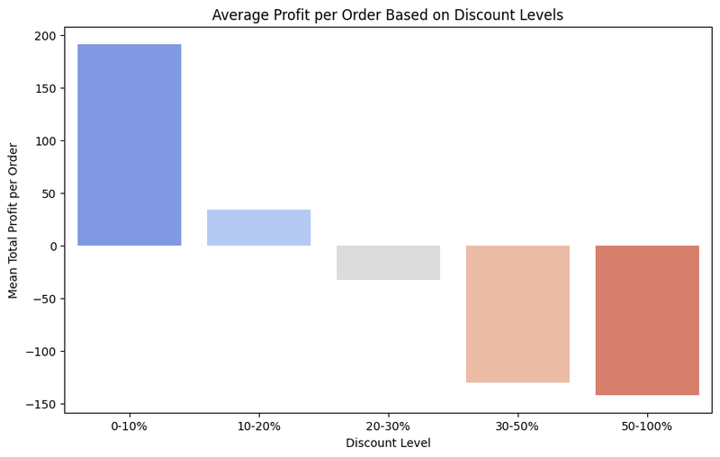
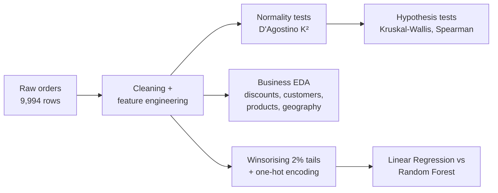
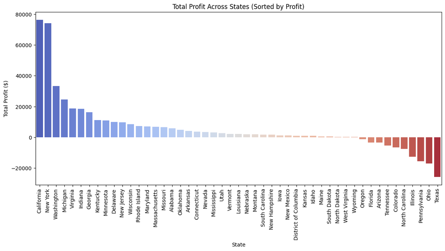
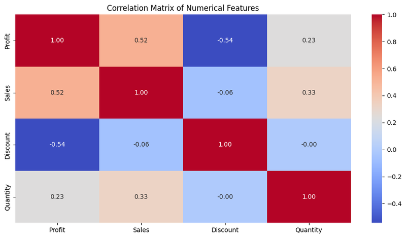
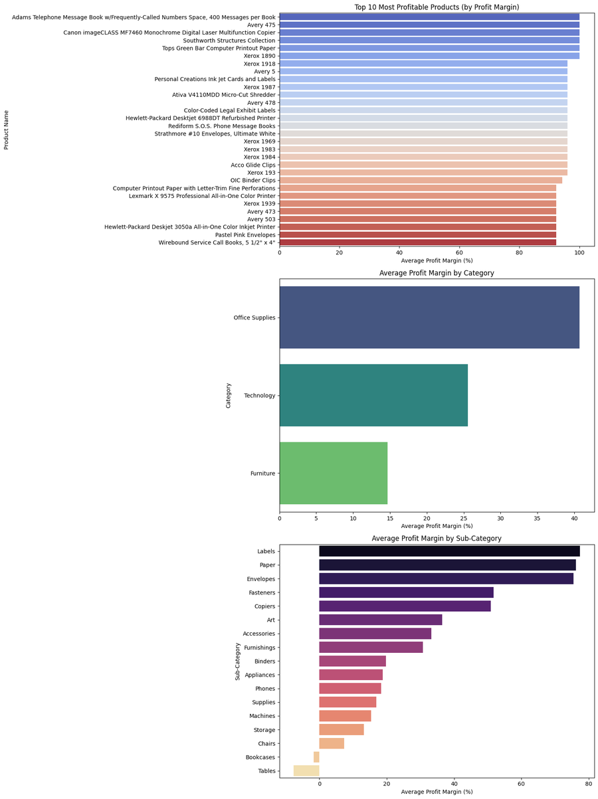
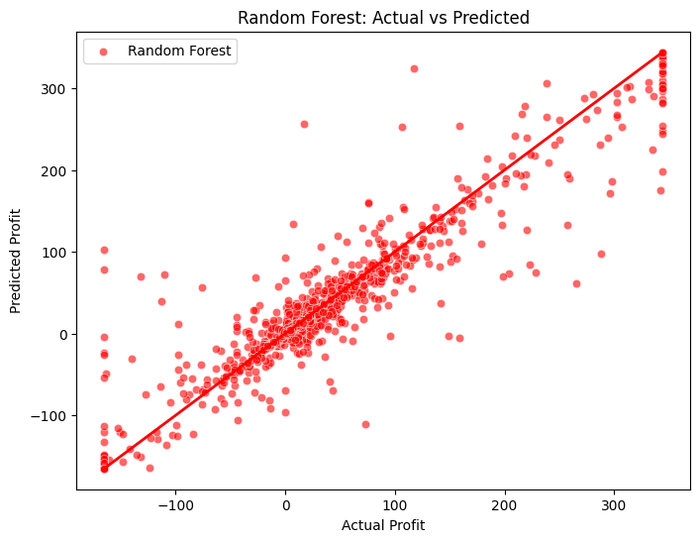

# What Drives Retail Profit? Superstore Statistical Analysis

A statistical learning study of **~10,000 retail orders** to find what makes a sale profitable or loss-making, combining hypothesis testing, customer and discount analysis, and predictive modelling with Random Forest.




## Highlights

- **Discounts destroy profit:** orders with discounts above 20% lose money on average, and discount is the strongest negative driver of profit (Spearman ρ = −0.54).
- **Profit is concentrated:** the top 20% of profitable customers generate **59%** of all positive profit, and the worst 20% of loss-making customers cause **71%** of all losses.
- **Predictive model:** a Random Forest explains **89% of the variance in order profit** (R² = 0.889), against 0.497 for linear regression.
- **Statistically rigorous:** non-parametric tests were chosen after normality tests showed that no key variable is normally distributed.

## Business questions

1. Which products, categories and regions are most and least profitable?
2. How do discounts affect profit?
3. Does profit differ across customer segments, shipping modes, regions and cities?
4. Which customers drive the most profit and the most losses?
5. Can order-level profit be predicted, and which features matter most?

## Data

- **[Sample Superstore dataset](data/Superstore.csv)** (included): 9,994 order lines from a US retailer, 2014–2017, with 21 columns covering orders, shipping, customers, location, products, sales, quantity, discount and profit.
- **Cleaning:** removed one duplicate row and dropped identifier-like columns.
- **Engineered features:** profit margin, profit per unit, delivery days, order year and day of week.

## Approach



## Key findings

**Hypothesis tests** (non-parametric, α = 0.05):

| Does profit differ across… | Test | Result |
|---|---|---|
| Customer segments | Kruskal–Wallis | **No** (p = 0.107) |
| Product categories / sub-categories | Kruskal–Wallis | Yes (p < 10⁻⁹⁶) |
| Regions | Kruskal–Wallis | Yes (p < 10⁻⁴⁸) |
| Cities | Kruskal–Wallis | Yes (p < 10⁻²⁴⁹) |
| Shipping modes | Kruskal–Wallis | Yes, weakly (p = 0.011) |

| Correlation with profit | Spearman ρ |
|---|---:|
| Discount | **−0.54** |
| Sales | +0.52 |
| Quantity | +0.23 |

**What this means for the business**
- **Cap discounts.** Average profit per order turns negative once the discount exceeds 20%.
- **Review loss-making sub-categories and cities** rather than whole segments. Segments behave similarly, but sub-categories and locations differ sharply.
- **Protect and target top customers,** and review pricing for the small group of customers responsible for most losses.

| Profit by sub-category | Correlations between key variables |
|---|---|
|  |  |

<details>
<summary>Profit margin by product, category and sub-category</summary>


</details>

## Predictive modelling

- **Target:** order-line profit, winsorised at the 2nd/98th percentiles to limit the influence of extreme outliers.
- **Features:** sales, quantity, discount, year, plus one-hot encoded shipping mode, segment, category, sub-category, region, state and city (614 features).
- **Validation:** 80/20 train/test split.

| Model | R² (test) |
|---|---:|
| Linear Regression (standardised features) | 0.497 |
| **Random Forest** (100 trees) | **0.889** |

Random Forest test error: MAE = 10.28, RMSE = 26.41 (in profit units).

**Most important features (Random Forest):** sales (0.47) and discount (0.32), followed by the copiers, binders and storage sub-categories.



The large gap between the two models shows that profit depends on **non-linear interactions**, especially between sales value and discount level, that a linear model can't capture.

## Repository structure

```
superstore-profit-analysis/
├── data/
│   └── Superstore.csv                    # input dataset
├── notebooks/
│   └── superstore_profit_analysis.ipynb  # cleaning, EDA, tests and models
├── figures/                              # figures used in this README
├── docs/
│   └── report_summary.md                 # summary of the project report
└── requirements.txt
```

## How to run

```bash
pip install -r requirements.txt
cd notebooks
jupyter notebook superstore_profit_analysis.ipynb
```

The notebook reads `../data/Superstore.csv` and writes intermediate cleaned files to the same folder. Interactive Plotly charts (maps, yearly trends) appear when you run the notebook locally; GitHub doesn't display them.

## Project context

Project for the *Statistical Learning and Data Analysis* course, MSc Data Science, University of Naples Federico II (February 2025). A summary of the project report is in [`docs/report_summary.md`](docs/report_summary.md).
